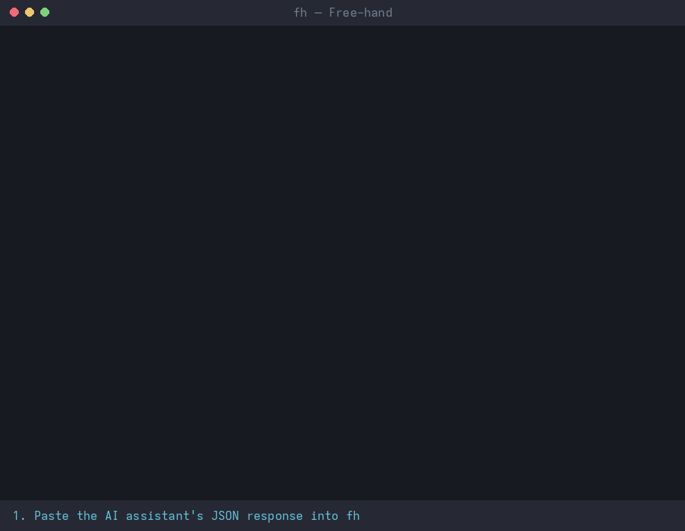

# Free-hand (`fh`)

## Purpose

Free-hand is for developers who still prefer to keep a human in the loop, at no cost. There are no API keys, no per-token billing, and no subscriptions beyond the free tier of whichever AI chat assistant you already use. You stay in control: you paste the assistant's response, review it, and approve every file write, Git change, and command before it runs.

## Overview



Free-hand is a lightweight, AI-agnostic Python CLI for a human-in-the-loop AI-to-local-tools workflow. It does not call an LLM API or make AI-provider network requests. It accepts AI-generated JSON tool-call responses, validates them, asks for approval before risky operations, runs local tools, and can copy the results back to your clipboard.

### Compatible chat assistants

Use any assistant that can follow the generated instructions and return the JSON tool-call envelope. The interaction is manual: paste the output from `fh prompt` into the chat, paste its JSON response into `fh run`, then return the execution results to the chat.

| Assistant | Notes |
|---|---|
| ChatGPT | Manual paste/execute workflow |
| DeepSeek | Manual paste/execute workflow |
| Claude | Manual paste/execute workflow |
| [Duck.ai](https://duck.ai/) | Manual paste/execute workflow; no Duck.ai API key is required |
| Gemini | Manual paste/execute workflow |
| Grok | Manual paste/execute workflow |
| Microsoft Copilot | Manual paste/execute workflow |
| Other assistants | Compatible when they can follow the generated instructions and return the required JSON envelope |

Free-hand is especially useful when you reach an AI service's usage limits or run out of available tokens. Switch to another AI chat assistant and continue working on the same project without changing your local development workflow.

## Requirements

- Python 3.14+
- [uv](https://docs.astral.sh/uv/) (recommended)
- No Python runtime dependencies
- Optional clipboard support for copying generated prompts and execution results. If unavailable, results remain saved and printed for manual copying.

## Install

### Shell installer (recommended)

Download, review, then run the installer. It creates an isolated virtual environment under `~/.local/share/free-hand` and links `fh` into `~/.local/bin`:

```sh
curl -fsSL https://raw.githubusercontent.com/josnin/free-hand/main/install.sh \
  -o install.sh
less install.sh
sh install.sh
```

Re-run `sh install.sh` to update. Requires Python 3.14+ on your `PATH`. Override locations with `FH_INSTALL_DIR` and `FH_BIN_DIR`. If `fh` is not found, add `~/.local/bin` to your `PATH`.

### From a checkout (development)

```sh
uv sync
uv run fh --help
```

`uv sync` creates `.venv` with Python 3.14 (pinned in `.python-version`) and installs the `fh` command in editable mode. Prefix commands with `uv run`, e.g. `uv run fh run`, or activate `.venv` to call `fh` directly. To update an existing checkout, run `uv sync` again.

## Quick start

```sh
fh init
fh tools
fh prompt > fh-system-prompt.txt
```

Copy the contents of `fh-system-prompt.txt` into your preferred AI assistant's instructions. Alternatively, run `fh prompt --copy` to copy the generated system prompt directly to your clipboard.

### Recommended interactive workflow

Start one persistent session from your project directory:

```sh
fh run
```

Then repeat this loop without restarting `fh`:

1. Copy the JSON response from your AI chat assistant.
2. Paste it into the running `fh` terminal.
3. Enter `END` on a line by itself to submit that response.
4. Free-hand validates the response and shows a diff-style preview (edits, new files) or the exact command for each operation that needs approval. After execution it prints a short activity summary, saves the full JSON results to `.free-hand/last-results.json`, and copies them to the clipboard when supported.
5. Paste the results back into your AI chat assistant and continue the task.

Enter `exit` at an empty `fh>` prompt or press Ctrl-C to close the session. If clipboard copying is unavailable, run `fh results` to print the JSON or open `.free-hand/last-results.json`.

For a one-off response file, use `fh run --input response.json`.

### JSON response format

```json
{
  "version": 1,
  "tool_calls": [
    {
      "id": "call_001",
      "type": "function",
      "function": {
        "name": "list_files",
        "arguments": {"pattern": "**/*"}
      }
    }
  ],
  "final_message": "Inspect the repository files."
}
```

## Commands

- `fh init` — create `.free-hand.json` in the current project.
- `fh prompt` — generate the system prompt and current tool schemas.
- `fh prompt --copy` — copy the generated system prompt to the clipboard.
- `fh tools` — show available tools, schemas, and risk levels.
- `fh run` — start the persistent paste/execute session; submit each response with `END`.
- `fh run --input response.json` — execute one response from a file.
- `fh results` — print the latest saved execution results.
- `fh results --copy` — print and copy the latest results when clipboard support is available.
- `fh validate response.json` — validate protocol and tool arguments without execution.
- `fh execute --input response.json` — execute a response file; risky operations require approval.
- `fh history` — show recent execution results.
- `fh config` — show effective settings.

## Response cleanup and JSON safety

Response cleanup tolerates Markdown fences and surrounding explanatory text by extracting the Free-hand JSON response envelope. It does **not** repair or rewrite JSON values. For example, `"pattern": "\\*"` is valid JSON representing a backslash followed by an asterisk, while `"pattern": "\*"` is invalid JSON. For a glob wildcard, use `"pattern": "*"` or omit the optional pattern to use the default. Invalid JSON is rejected before any tool runs.

## Registered tools

- `read_file(path)` — read a permitted UTF-8 project file.
- `list_files(pattern?)` — list permitted files matching a glob.
- `search_files(query, literal?)` — search exact text by default; `literal: false` uses smart-case regular expressions.
- `write_file(path, content)` — create a new file; refuses to overwrite.
- `edit_file(path, old_text, new_text)` — replace exactly one occurrence in an existing file.
- `git_status()` — inspect the current Git working tree.
- `git_diff(staged?, paths?)` — inspect working-tree or staged diffs.
- `git_stage(paths)` — stage explicitly selected paths.
- `git_commit(message?)` — commit staged changes.
- `run_command(argv)` — run a command as an argv array, without a shell.

## Safety

- File paths must remain within the project root; path traversal and symlink escapes are rejected.
- Secret-like paths such as `.env`, private keys, and `credentials` are blocked by default.
- `write_file` refuses to overwrite existing files. `edit_file` requires the old text to occur exactly once.
- `run_command` uses an argument array with `shell=False` and requires approval.
- File edits/writes, Git staging/commits, and commands require interactive approval.
- Git staging requires explicit paths; inspect status and diffs before staging or committing. Free-hand cannot independently know which changes were authored by an external agent.
- Execution halts after the first rejected or failed call; later calls are marked skipped.
- Input and tool output sizes are bounded.

## Development

Run tests with `uv run pytest -q`.

The demo GIF is generated from a real `fh run` session; regenerate it after changing the output format with `uv run --with pillow python scripts/make_demo_gif.py`.

### Clipboard behavior

On Linux, Free-hand tries OSC 52 for copying when stdout is an interactive terminal. If that is unavailable, it tries a suitable X11 or Wayland clipboard utility. Terminal support varies. On macOS it uses `pbcopy`; on Windows it uses PowerShell. Clipboard support is optional: execution results are always printed and saved to `.free-hand/last-results.json`.
